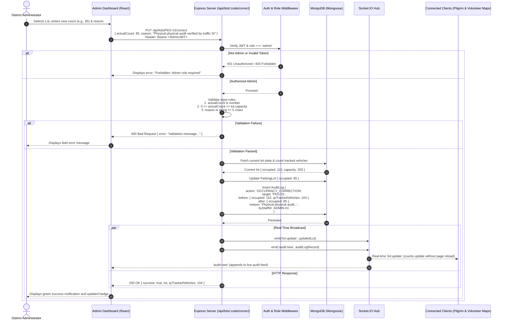

# PushkarPath — Admin Occupancy Correction Workflow

In massive crowd gatherings like Godavari Pushkaralu, discrepancies between sensor/QR gate counts and physical on-ground vehicle occupancy can occur (e.g., emergency service vehicles waved through gates, VIP arrivals, or temporary blockades).

PushkarPath provides administrators with an authorized override mechanism while ensuring full audit accountability. Every manual adjustment is tracked in an immutable audit ledger with mandatory justifications.

---

## Sequence Diagram

---

## Validation & Business Rules

1. **Role Enforcement**:
   - Only accounts with `role: 'admin'` are authorized to call `PUT /api/lots/:code/correct`.
   - Volunteer and ground staff tokens (`role: 'staff'`) receive `HTTP 403 Forbidden`.

2. **Count Range Boundary**:
   - `actualCount` must be an integer.
   - `0 <= actualCount <= lot.capacity`.
   - Any value `< 0` or `> lot.capacity` is rejected with `HTTP 400 Bad Request`.

3. **Mandatory Justification**:
   - The `reason` field is mandatory.
   - Must be a non-empty string with at least **5 characters**.
   - Ensures an auditable paper trail explaining why on-ground counts diverged from digital gate scans.

4. **Audit Trail Immutability**:
   - An immutable record is created in `AuditLog` capturing:
     - `target`: The lot code (e.g. `'PKG-01'`).
     - `before`: Prior `occupied` count and count of `qrTrackedVehicles`.
     - `after`: New `actualCount`.
     - `reason`: The administrator's justification note.
     - `byStaffId`: ID of the admin making the change.
     - `createdAt`: ISO timestamp.

5. **Instantaneous Client Propagation**:
   - Calling `emitLotUpdate(lot)` broadcasts the new available capacity to all open pilgrim browsers and mobile devices within milliseconds.
   - If a lot was previously red (full), the map marker immediately transitions back to green or amber, opening traffic flow.
