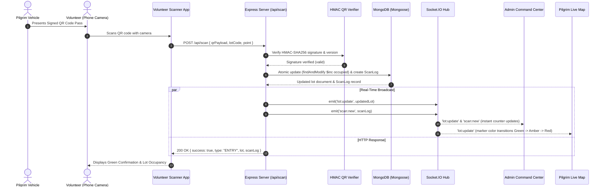

# PushkarPath — System Architecture

PushkarPath is a real-time smart parking discovery, navigation, and occupancy management system engineered for **Godavari Pushkaralu 2027** in Rajahmundry, Andhra Pradesh.

During peak bathing dates, hundreds of thousands of pilgrims arrive by car, bus, and two-wheeler. PushkarPath coordinates traffic ingress, routes pilgrims to available parking lots clustered near target bathing ghats, issues cryptographically tamper-proof digital vehicle passes, and provides volunteer staff and district administrators with instantaneous visibility over parking pressure.

---

## High-Level Architecture Diagram

```mermaid
flowchart TB
    subgraph ClientLayer["Frontend Client Layer (React 18 + Vite + Tailwind CSS)"]
        direction TB
        PilgrimUI["Pilgrim Portal / Mobile Web<br/>(Guest View & OTP Auth)"]
        VolunteerUI["Volunteer Scanner Portal<br/>(Camera QR Scanner & Gate Ops)"]
        AdminUI["Admin Command Center<br/>(Crowd Pressure, Lots, Staff, Audits)"]
        SimUI["Traffic Simulation Live Map<br/>(Corridors, Density & Routing)"]
    end

    subgraph ServerLayer["Backend Application Layer (Node.js & Express)"]
        direction TB
        ExpressApp["Express API Server (Port 5000)<br/>- Security & Helmet<br/>- JSON & Compression<br/>- Rate Limiting (OTP & Staff)"]
        
        subgraph Routes["API Routers"]
            AuthR["/api/auth<br/>OTP & Staff Passcodes"]
            LotsR["/api/lots<br/>Occupancy & Corrections"]
            GhatsR["/api/ghats<br/>Ghat Directory & Distance"]
            VehR["/api/vehicles<br/>Registration & QR Passes"]
            ScanR["/api/scan<br/>Atomic Gate Entry/Exit"]
            StaffR["/api/staff<br/>Staff & Volunteer Ops"]
            AdminR["/api/admin<br/>Cluster Pressure Overview"]
            LogsR["/api/logs<br/>Scan & Audit Queries"]
            MapR["/api/map<br/>Proxy & Caching"]
            SimR["/api/sim<br/>Traffic Simulation API"]
        end

        SocketServer["Socket.IO Real-time Engine<br/>Events: lot:update, lots:changed, ghats:changed,<br/>scan:new, audit:new, sim:tick"]
        SimEngine["Traffic Simulation Engine<br/>- Cellular Automaton Model<br/>- NH16 & Godavari Corridors<br/>- Route Polyline Interpolation"]
    end

    subgraph DataLayer["Persistence & Database Layer"]
        MongoDB[("MongoDB Database<br/>- Mongoose ODM<br/>- Atomic Operations ($inc, $expr)<br/>- 6 Collections: Users, Lots, Ghats,<br/>  Vehicles, ScanLogs, AuditLogs")]
    end

    subgraph ExternalServices["External Geographic Services"]
        OSRM["OSRM Public Routing API<br/>(Driving & Walking Polylines)"]
        Photon["Photon Geocoding (Komoot)<br/>(Location Search Proxy)"]
        OSMTiles["OpenStreetMap Tile Servers<br/>(Leaflet Raster Map Tiles)"]
    end

    %% Client to Server interactions
    PilgrimUI -- "REST API (Bearer JWT)" --> ExpressApp
    VolunteerUI -- "REST API (Bearer JWT)" --> ExpressApp
    AdminUI -- "REST API (Bearer JWT)" --> ExpressApp
    SimUI -- "REST API" --> ExpressApp

    %% Real-time Socket.IO bi-directional connections
    SocketServer <== "WebSocket / Long-polling (Bi-directional)" ==> PilgrimUI
    SocketServer <== "WebSocket / Long-polling (Bi-directional)" ==> VolunteerUI
    SocketServer <== "WebSocket / Long-polling (Bi-directional)" ==> AdminUI
    SocketServer <== "WebSocket / Long-polling (Bi-directional)" ==> SimUI

    %% Internal Server routing
    ExpressApp --> Routes
    Routes --> MongoDB
    Routes --> SocketServer
    SimEngine --> SocketServer

    %% External proxy routes
    MapR -- "Rate Limited (1 req/sec) + LRU Cache<br/>User-Agent: PushkarPath/1.0" --> OSRM
    MapR -- "Rate Limited (1 req/sec) + LRU Cache<br/>User-Agent: PushkarPath/1.0" --> Photon
    PilgrimUI -. "Direct Leaflet tile fetching" .-> OSMTiles
```



---

## Volunteer Scan & Real-Time Broadcast Architecture

The following diagram illustrates how a volunteer gate scan is processed atomically and immediately broadcast to all connected devices across the city:



---

## Architectural Principles & Design Decisions

### 1. Zero Pre-Booking Guarantee
PushkarPath deliberately does **not** provide advance booking or parking space reservations. Godavari Pushkaralu generates extreme arrival volatility due to dynamic highway traffic, VIP motorcades, and fluctuating auspicious bathing times (*Muhurtham*). Advance reservations cause artificial holding of slots, street hoarding, and physical gate conflicts. PushkarPath functions strictly as a **discovery, guidance, and atomic gate validation engine**.

### 2. Micro-Proxy for Geographic Services
To adhere strictly to OSM and Photon usage policies without subjecting the client to CORS or rate-limit blocks:
- All external calls to OSRM (`router.project-osrm.org`) and Photon (`photon.komoot.io`) are routed through backend proxy endpoints (`/api/map/route` and `/api/map/search`).
- **User-Agent:** All outgoing queries send `User-Agent: PushkarPath/1.0 (pushkarpath-demo@example.com)`.
- **In-Memory Caching:** Frequently requested routes (e.g., between highway checkposts and major lots) and repeated search terms are cached to minimize network egress.
- **Rate-Limiter Bottlenecks:** External queries are throttled with a 1-request-per-second leaky bucket queue.

### 3. Cryptographically Signed Offline-Verifiable QR Passes
Vehicle passes consist of a JSON payload containing:
- `v`: Vehicle Registration Number (uppercase, stripped of punctuation).
- `ver`: Version integer (incremented on re-issue to revoke old passes).
- `sig`: HMAC-SHA256 hash generated using `QR_SECRET`.

Even if a malicious actor generates fraudulent QR codes, the server verifies the cryptographic signature with constant-time buffer comparison (`crypto.timingSafeEqual`) to prevent timing attacks.

### 4. Atomic Concurrency Control
Race conditions during peak rushes (multiple volunteers admitting vehicles into the final remaining space of a lot simultaneously) are eliminated using MongoDB's atomic operator queries:
```javascript
const updatedLot = await ParkingLot.findOneAndUpdate(
  {
    code: lot.code,
    status: 'open',
    $expr: { $lt: ['$occupied', '$capacity'] }
  },
  { $inc: { occupied: 1 } },
  { new: true }
);
```
If two requests execute concurrently when `capacity - occupied === 1`, only the first atomic update succeeds. The second returns `null`, prompting the server to find and suggest the nearest alternate open lot with available spaces.

### 5. Multi-Role Server Authorization
Every endpoint validates authorization using server-side middleware:
- **Public**: Lot directory, ghat listings, reverse geocoding, route calculation.
- **Pilgrim (`user`)**: Vehicle registration (max 3 per account), my vehicles list, digital pass viewing.
- **Volunteer (`staff`)**: Gate scanning (`/api/scan`), viewing vehicles inside assigned lot.
- **Admin (`admin`)**: Manual occupancy corrections (`/api/lots/:code/correct`), lot capacity changes, staff management, audit log viewing, simulation controls.
