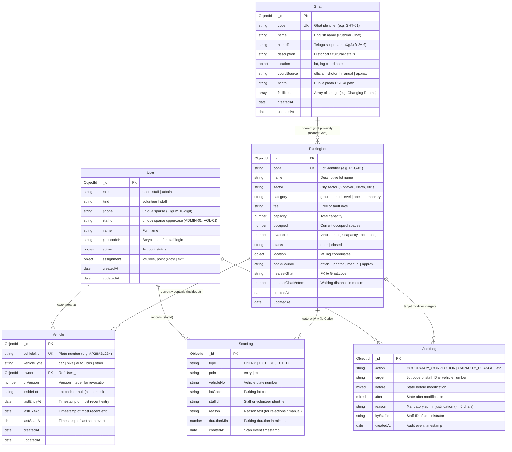

# PushkarPath — Data Model & Schema Specification

PushkarPath models parking lots, holy bathing ghats, registered vehicles, volunteer staff, atomic gate scans, and administrative audit logs using MongoDB and Mongoose.

---

## Entity-Relationship Diagram

---

## Collections & Schemas

### 1. `users` Collection
Represents all system actors: pilgrims (role: `'user'`), ground volunteers (role: `'staff'`, kind: `'volunteer'`), senior staff (role: `'staff'`, kind: `'staff'`), and district administrators (role: `'admin'`).

| Field | Type | Required | Description |
|---|---|---|---|
| `_id` | ObjectId | Auto | Primary Key |
| `role` | String | Yes | Enum: `['user', 'staff', 'admin']` (Default: `'user'`) |
| `kind` | String | Conditional | Enum: `['volunteer', 'staff']`. Defaults to `'volunteer'` when role is `'staff'`. |
| `phone` | String | No | Cleaned 10-digit mobile number for pilgrim OTP authentication. Sparse unique index. |
| `staffId` | String | No | Uppercase staff identifier (e.g., `'ADMIN-01'`, `'VOL-01'`). Sparse unique index. |
| `name` | String | No | Display name. |
| `passcodeHash` | String | No | Salted bcrypt hash of staff passcode. Null for pilgrims. |
| `active` | Boolean | Yes | Account active status (Default: `true`). Deactivated users cannot authenticate. |
| `assignment` | Object | No | Contains `{ lotCode: String, point: 'entry' | 'exit' | null }`. Dictates volunteer gate assignment. |
| `createdAt` | Date | Auto | Creation timestamp. |
| `updatedAt` | Date | Auto | Modification timestamp. |

**Indexes:**
- `{ phone: 1 }` (sparse)
- `{ staffId: 1 }` (unique, sparse)

---

### 2. `parkinglots` Collection
Defines physical parking lots across Rajahmundry.

| Field | Type | Required | Description |
|---|---|---|---|
| `code` | String | Yes | Unique uppercase lot code (e.g., `'PKG-01'`). Primary lookup key. |
| `name` | String | Yes | Name of the lot (e.g., `'Pushkar Ghat Main Parking'`). |
| `sector` | String | No | City cluster/sector (e.g., `'Godavari Central'`, `'Diwancheruvu Corridor'`). |
| `category` | String | Yes | Enum: `['ground', 'multi-level', 'open', 'temporary']` (Default: `'ground'`). |
| `fee` | String | No | Parking tariff description (e.g., `'Free'`, `'₹20 / 4 hrs'`). |
| `capacity` | Number | Yes | Total vehicular spaces. Must be `>= 0`. |
| `occupied` | Number | Yes | Current vehicles parked. Must be `>= 0` and `<= capacity`. |
| `status` | String | Yes | Enum: `['open', 'closed']` (Default: `'open'`). |
| `location` | Object | Yes | Geo-coordinates: `{ lat: Number, lng: Number }`. |
| `coordSource` | String | Yes | Enum: `['official', 'photon', 'manual', 'approx']`. Tracks coordinate quality. |
| `nearestGhat` | String | No | Uppercase code of nearest sacred bathing ghat (e.g., `'GHT-01'`). |
| `nearestGhatMeters` | Number | No | Walking distance in meters from lot to nearest ghat. |
| `available` | Virtual | N/A | Computed on the fly as `Math.max(0, capacity - occupied)`. |

**Indexes:**
- `{ code: 1 }` (unique)
- `{ status: 1 }`
- `{ sector: 1 }`

---

### 3. `ghats` Collection
Catalog of sacred bathing ghats along the Godavari River.

| Field | Type | Required | Description |
|---|---|---|---|
| `code` | String | Yes | Unique uppercase ghat code (e.g., `'GHT-01'`). |
| `name` | String | Yes | English name (e.g., `'Pushkar Ghat'`). |
| `nameTe` | String | No | Telugu localized name (e.g., `'పుష్కర్ ఘాట్'`). |
| `description` | String | No | Historical significance, safety notices, and rituals. |
| `location` | Object | Yes | Coordinates: `{ lat: Number, lng: Number }`. |
| `coordSource` | String | Yes | Enum: `['official', 'photon', 'manual', 'approx']`. |
| `photo` | String | No | Photo URL or static asset path. |
| `facilities` | [String] | No | Array of amenities (e.g., `['Changing Rooms', 'Medical Post', 'Drinking Water']`). |

**Indexes:**
- `{ code: 1 }` (unique)

---

### 4. `vehicles` Collection
Tracks registered pilgrim vehicles and their live gate state.

| Field | Type | Required | Description |
|---|---|---|---|
| `vehicleNo` | String | Yes | Normalized registration number (e.g., `'AP28AB1234'`). Uppercase, unique. |
| `vehicleType` | String | Yes | Enum: `['car', 'bike', 'auto', 'bus', 'other']`. |
| `owner` | ObjectId | No | References `User._id`. |
| `qrVersion` | Number | Yes | Current active QR version integer (starts at 1). Re-issuing increments this. |
| `insideLot` | String | No | Lot code currently parked in, or `null` if vehicle is outside. |
| `lastEntryAt` | Date | No | Timestamp of latest gate entry scan. |
| `lastExitAt` | Date | No | Timestamp of latest gate exit scan. |
| `lastScanAt` | Date | No | Timestamp of last scan activity (used for anti-passback / cooldowns). |

**Indexes:**
- `{ vehicleNo: 1 }` (unique)
- `{ owner: 1 }`
- `{ insideLot: 1 }`

---

### 5. `scanlogs` Collection
Immutable append-only operational log recording every gate scan attempt.

| Field | Type | Required | Description |
|---|---|---|---|
| `type` | String | Yes | Enum: `['ENTRY', 'EXIT', 'REJECTED']`. |
| `point` | String | Yes | Enum: `['entry', 'exit']`. |
| `vehicleNo` | String | Yes | Scanned plate number. |
| `lotCode` | String | Yes | Lot code where scan occurred. |
| `staffId` | String | Yes | ID of volunteer or administrator performing scan. |
| `reason` | String | No | Explanatory reason if rejected or manual override. |
| `durationMin` | Number | No | Calculated parking stay in minutes (for `'EXIT'` scans). |
| `createdAt` | Date | Auto | Timestamp of scan. |

**Indexes:**
- `{ createdAt: -1 }`
- `{ vehicleNo: 1, createdAt: -1 }`
- `{ lotCode: 1, createdAt: -1 }`
- `{ type: 1, createdAt: -1 }`

---

### 6. `auditlogs` Collection
Immutable security audit trail capturing all administrative mutations.

| Field | Type | Required | Description |
|---|---|---|---|
| `action` | String | Yes | Action code (e.g., `'OCCUPANCY_CORRECTION'`, `'CAPACITY_CHANGE'`, `'STAFF_CREATED'`). |
| `target` | String | Yes | Primary target modified (lot code, vehicle plate, staffId). |
| `before` | Mixed | No | Snapshot of entity before mutation. |
| `after` | Mixed | No | Snapshot of entity after mutation. |
| `reason` | String | Yes | Mandatory justification text (enforced `>= 5` characters). |
| `byStaffId` | String | Yes | ID of administrator authorizing mutation. |
| `createdAt` | Date | Auto | Timestamp of modification. |

**Indexes:**
- `{ createdAt: -1 }`
- `{ action: 1, createdAt: -1 }`
- `{ target: 1 }`
- `{ byStaffId: 1 }`
