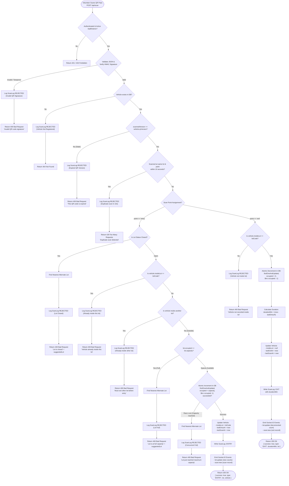

# PushkarPath — QR Scan Flow Specification

The digital vehicle pass is the core coordination mechanism at parking gates across Rajahmundry. This document details the exact cryptographic verification, duplicate suppression, admission policy checks, atomic database transitions, and real-time Socket.IO broadcasts that occur when a volunteer scans a pass.

---

## QR Code Structure

Each vehicle pass encodes a JSON object with three fields:
```json
{
  "v": "AP28AB1234",
  "ver": 1,
  "sig": "3a8c7e9..."
}
```
- **`v`**: Uppercase alphanumeric registration number.
- **`ver`**: Integer QR version (starting at 1). Incrementing `ver` revokes previous physical/digital passes.
- **`sig`**: HMAC-SHA256 signature calculated over `${v}:${ver}` using `process.env.QR_SECRET`.

---

## Complete Scan Process Flowchart



---

## Detailed Step-by-Step Processing

### 1. Authentication & Permission Verification
- The request must bear a valid JWT in the `Authorization: Bearer <token>` header.
- The user must have role `'staff'` or `'admin'`.
- The user account must be active (`active === true`).
- Gate assignment (`lotCode` and `point`) is extracted from the staff user's profile or allowed via admin override.

### 2. Cryptographic Signature Validation
- The `qrPayload` parameter can be a JSON string or an already parsed object.
- The HMAC signature is re-computed using the server's private `process.env.QR_SECRET`.
- Time-constant comparison (`crypto.timingSafeEqual`) ensures resilience against timing side-channel attacks.
- If signature check fails:
  - Writes a `REJECTED` scan log with reason `'Invalid QR signature'`.
  - Responds with `HTTP 400` and emits `scan:new` via Socket.IO.

### 3. Version Check & Stale Pass Invalidation
- If an admin previously reissued a pass for vehicle `AP28AB1234`, its database record has `qrVersion = 2`.
- Any driver presenting a printed screenshot of version 1 is rejected immediately.
- Responds with `HTTP 400` (`'This QR code is expired'`).

### 4. Rapid Re-Scan Suppression (10-Second Cooldown)
- To prevent accidental double-scans from sensitive phone cameras or double-taps:
- The system checks if a scan log for the same vehicle, lot, and point was created in the last 10 seconds.
- If found, returns `HTTP 429 Too Many Requests`.

### 5. Admission Logic (Point: `entry`)
- **Status Check**: If the lot status is `'closed'`, entry is refused. The server calculates distances to other open lots with available space and returns the closest candidate under `suggestedLot`.
- **Anti-Passback (Same Lot)**: If `vehicle.insideLot === lot.code`, entry is refused with `'Vehicle already inside this lot'`.
- **Anti-Passback (Different Lot)**: If `vehicle.insideLot` is set to any other lot, entry is refused with `'Vehicle is currently recorded inside lot [OTHER] and must exit first'`.
- **Atomic Capacity Increment**:
  ```javascript
  const updatedLot = await ParkingLot.findOneAndUpdate(
    { code: lot.code, status: 'open', $expr: { $lt: ['$occupied', '$capacity'] } },
    { $inc: { occupied: 1 } },
    { new: true }
  );
  ```
  This atomic database operation guarantees zero over-allocation even under high concurrency.
- If successful, vehicle state is updated, a `ScanLog` of type `ENTRY` is created, and Socket.IO emits `lot:update` and `scan:new`.

### 6. Exit Logic (Point: `exit`)
- Checks if `vehicle.insideLot === lot.code`. If the vehicle was never recorded as entering this lot, exit is rejected.
- Decrements `occupied` atomically down to a minimum of 0.
- Computes `durationMin = Math.round((now - lastEntryAt) / 60000)`.
- Updates `vehicle.insideLot = null`.
- Writes a `ScanLog` of type `EXIT` recording `durationMin`.
- Broadcasts real-time events over Socket.IO so all pilgrims immediately see the newly freed parking space.
